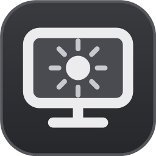
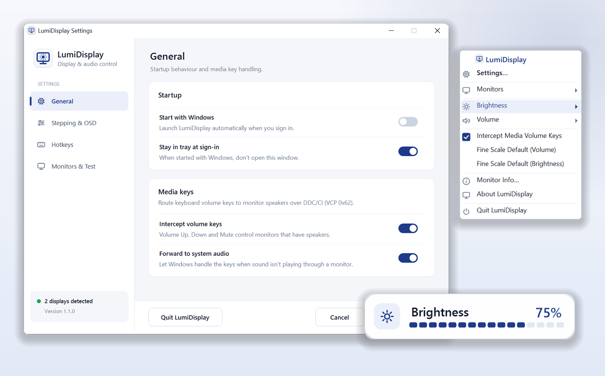
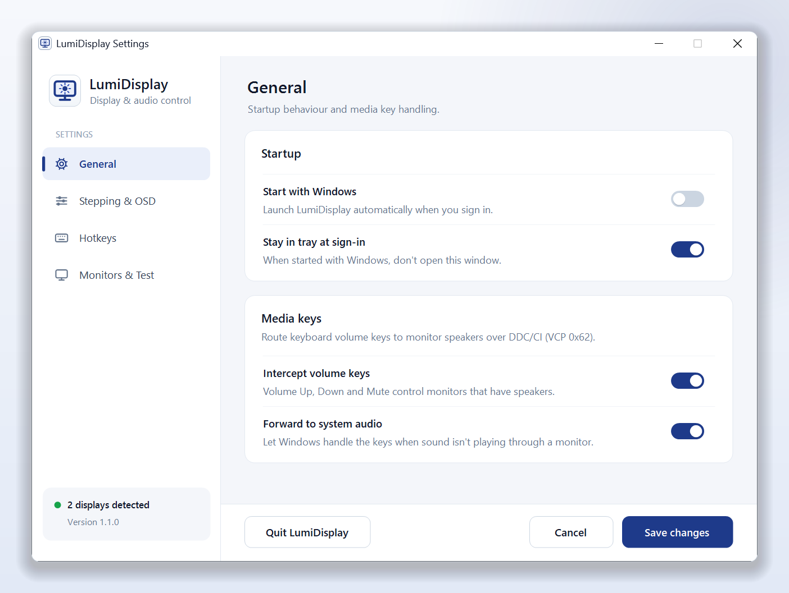
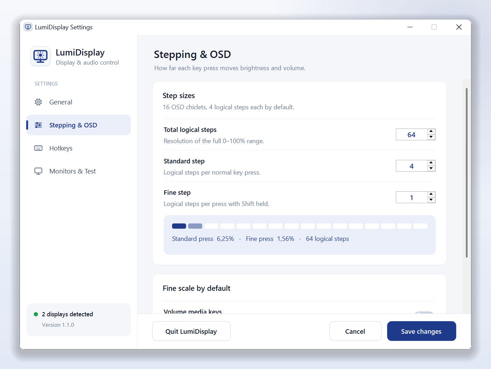
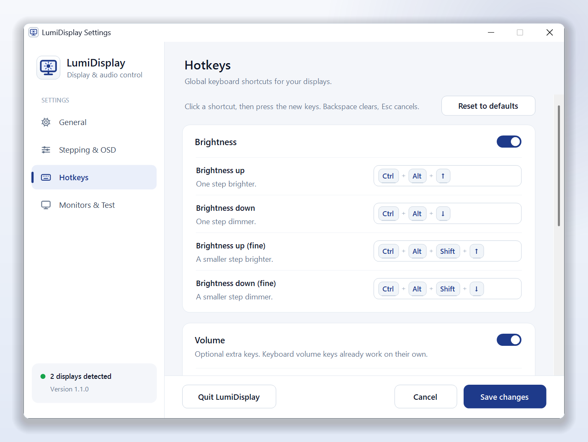
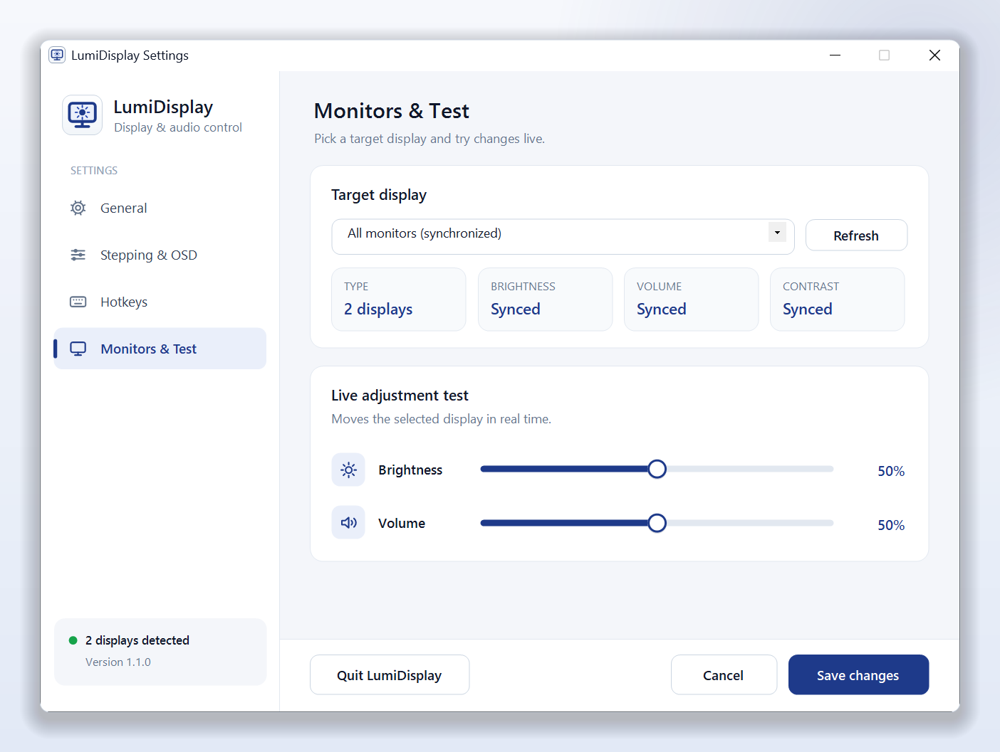
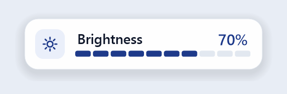
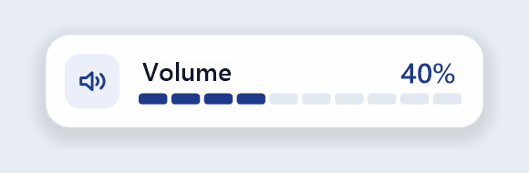

<p align="right">
  <a href="README.md">English</a> · <b>Bahasa Indonesia</b>
</p>

<p align="center">
  
</p>

<h1 align="center">LumiDisplay</h1>

<p align="center">
  Atur <b>kecerahan</b>, <b>kontras</b>, dan <b>volume speaker</b> monitor langsung dari keyboard di Windows,<br>
  lengkap dengan tampilan indikator di layar (OSD) bergaya macOS.
</p>

<p align="center">
  <a href="https://github.com/andikatahang/LumiDisplay/releases/latest"></a>
  
  <a href="LICENSE"></a>
</p>

<p align="center">
  <a href="https://github.com/andikatahang/LumiDisplay/releases/latest/download/LumiDisplay.exe"><b>⬇ Unduh LumiDisplay.exe</b></a>
  &nbsp;·&nbsp;
  <a href="https://github.com/andikatahang/LumiDisplay/releases">Semua rilis</a>
</p>

<p align="center">
  
</p>

## Fitur

- **Kecerahan & kontras hardware** untuk monitor eksternal lewat DDC/CI, juga untuk layar laptop.
- **Volume speaker monitor** — tombol volume dan mute di keyboard mengatur speaker bawaan monitor.
- **Shortcut keyboard** untuk kecerahan (langkah normal dan halus) serta kontras.
- **Indikator di layar (OSD)** dengan 16 tingkat seperti macOS, jadi level saat ini selalu terlihat.
- **Berjalan di system tray** — ada preset cepat, pilihan monitor yang dikontrol, dan bisa ikut menyala bersama Windows.
- **Portabel** — cukup satu file `.exe`, tanpa installer, tanpa perlu memasang .NET.

## Cara instal

1. **[Unduh `LumiDisplay.exe`](https://github.com/andikatahang/LumiDisplay/releases/latest/download/LumiDisplay.exe)**, lalu pindahkan ke folder tetap, misalnya `C:\Users\<nama-anda>\Apps\LumiDisplay\`.
2. **Klik dua kali file tersebut.** Kalau muncul peringatan SmartScreen *"Windows protected your PC"*, klik **More info → Run anyway** (aplikasi ini belum memiliki tanda tangan digital).
3. Jendela pengaturan akan terbuka. Nyalakan **Start with Windows** kalau ingin LumiDisplay otomatis berjalan setiap kali masuk Windows.

> **Monitor eksternal tidak merespons?** Buka menu bawaan monitor (tombol fisik di monitor), lalu pastikan **DDC/CI** dalam posisi **On**. Sebagian besar monitor sudah aktif dari pabrik, tapi tidak semuanya.

**Kebutuhan sistem:** Windows 10 (1809+) atau Windows 11, 64-bit.

## Cara pakai

| Shortcut | Fungsi |
|---|---|
| <kbd>Ctrl</kbd> + <kbd>Alt</kbd> + <kbd>↑</kbd> / <kbd>↓</kbd> | Naikkan / turunkan kecerahan |
| <kbd>Ctrl</kbd> + <kbd>Alt</kbd> + <kbd>Shift</kbd> + <kbd>↑</kbd> / <kbd>↓</kbd> | Naikkan / turunkan kecerahan dengan langkah halus |
| <kbd>Ctrl</kbd> + <kbd>Alt</kbd> + <kbd>→</kbd> / <kbd>←</kbd> | Naikkan / turunkan kontras |
| <kbd>Volume +</kbd> / <kbd>Volume −</kbd> / <kbd>Mute</kbd> | Volume dan mute speaker monitor |

**Atur shortcut sesuka Anda:** buka **Settings → Hotkeys**, klik sebuah shortcut, lalu tekan kombinasi tombol yang diinginkan. Semua shortcut kecerahan dan kontras bisa diganti, dan Anda bisa menambahkan tombol sendiri untuk menaikkan/menurunkan volume dan mute speaker monitor. Backspace menghapus shortcut, **Reset to defaults** mengembalikan shortcut bawaan di atas.

- **Membuka jendela:** jalankan `LumiDisplay.exe` lagi, atau klik ikon di tray.
- **Menutup jendela:** LumiDisplay tetap berjalan di tray, jadi tombol-tombol tetap berfungsi.
- **Keluar sepenuhnya:** klik **Quit LumiDisplay** di jendela, atau klik kanan ikon tray → **Quit LumiDisplay**.
- **Klik kanan ikon tray** untuk preset kecerahan/volume (0–100%), memilih monitor yang dikontrol, dan melihat info monitor.

## Tangkapan layar

| | |
|---|---|
|  |  |
|  |  |

<p align="center">
  
  
</p>

## Mengatasi masalah

<details>
<summary><b>Tombol kecerahan tidak berpengaruh ke monitor eksternal</b></summary>

- Nyalakan **DDC/CI** di menu bawaan monitor.
- Gunakan kabel HDMI, DisplayPort, atau USB-C langsung dari GPU. Beberapa dock, KVM switch, dan adapter memblokir DDC/CI.
- Buka halaman **Monitors & Test** di LumiDisplay: kalau kecerahan sebuah monitor tertulis *N/A*, berarti Windows tidak bisa berkomunikasi dengannya lewat DDC/CI.
</details>

<details>
<summary><b>Tombol volume masih mengubah volume Windows</b></summary>

LumiDisplay hanya mengambil alih tombol volume kalau **Intercept volume keys** aktif *dan* monitor yang dipilih memiliki speaker yang terbaca lewat DDC/CI. Kalau **Forward to system audio** aktif (bawaan), tombol volume juga tetap dipegang Windows selama suara diputar lewat perangkat selain monitor, misalnya headphone atau speaker laptop.
</details>

<details>
<summary><b>Muncul "Windows protected your PC" saat dibuka</b></summary>

Itu peringatan SmartScreen untuk aplikasi tanpa tanda tangan digital yang diunduh dari internet. Klik **More info → Run anyway**. Anda bisa mencocokkan file unduhan dengan `SHA256SUMS.txt` di halaman rilis.
</details>

<details>
<summary><b>Shortcut bentrok dengan aplikasi lain</b></summary>

Shortcut berlaku di seluruh sistem, jadi satu kombinasi hanya bisa dipakai satu aplikasi. Kalau aplikasi lain sudah memakai salah satu shortcut Anda, LumiDisplay menampilkan notifikasi dan menandai shortcut itu dengan warna merah di **Settings → Hotkeys** — klik lalu pilih kombinasi lain.
</details>

## Cara uninstall

1. Di LumiDisplay, matikan **Start with Windows**, lalu klik **Quit LumiDisplay**.
2. Hapus file `LumiDisplay.exe`.
3. Kalau mau, hapus juga folder pengaturan: `%LocalAppData%\LumiDisplay`.

## Build dari source

<details>
<summary>Petunjuk</summary>

Membutuhkan [.NET 8 SDK](https://dotnet.microsoft.com/download/dotnet/8.0).

```bash
git clone https://github.com/andikatahang/LumiDisplay.git
cd LumiDisplay
dotnet build src/LumiDisplay/LumiDisplay.csproj
```

Build portabel satu file (sama seperti versi rilis):

```bash
dotnet publish src/LumiDisplay/LumiDisplay.csproj -c Release -r win-x64 --self-contained true -p:PublishSingleFile=true -p:EnableCompressionInSingleFile=true -o publish/
```

Push tag seperti `v1.2.0` akan otomatis membuat dan menerbitkan GitHub Release (`.github/workflows/release.yml`).

Flag untuk developer:
- `--autostart` — dipakai oleh entri startup Windows; tetap di tray kalau *Stay in tray at sign-in* aktif.
- `--export-icon <path>` — membuat ulang `lumidisplay.ico` dari kode logo di `Theme.cs`.
</details>

## Cara kerja

<details>
<summary>Arsitektur</summary>

| Bagian | Implementasi | Source |
|---|---|---|
| Monitor eksternal | DDC/CI lewat `dxva2.dll` (`SetVCPFeature` / `GetVCPFeatureAndVCPFeatureReply`) — VCP `0x10` kecerahan, `0x12` kontras, `0x62` volume, `0x8D` mute | [`DdcMonitor.cs`](src/LumiDisplay/DdcMonitor.cs) |
| Layar laptop | WMI `root\wmi` — `WmiMonitorBrightness` / `WmiSetBrightness` | [`WmiMonitor.cs`](src/LumiDisplay/WmiMonitor.cs) |
| Tombol volume | Hook keyboard tingkat rendah (`WH_KEYBOARD_LL`) | [`MediaKeyInterceptor.cs`](src/LumiDisplay/MediaKeyInterceptor.cs) |
| Shortcut | `RegisterHotKey` | [`HotkeyManager.cs`](src/LumiDisplay/HotkeyManager.cs) |
| Indikator di layar | Layered window dengan alpha per piksel (`UpdateLayeredWindow`) | [`OsdOverlay.cs`](src/LumiDisplay/OsdOverlay.cs) |
| Antarmuka | WinForms dengan kontrol yang digambar sendiri, tema terang | [`SettingsForm.cs`](src/LumiDisplay/SettingsForm.cs), [`ThemedControls.cs`](src/LumiDisplay/ThemedControls.cs), [`Theme.cs`](src/LumiDisplay/Theme.cs) |
| Pengaturan | JSON di `%LocalAppData%\LumiDisplay\settings.json` | [`AppSettings.cs`](src/LumiDisplay/AppSettings.cs) |

Pembagian langkah mengikuti BetterDisplay di macOS: 64 langkah logis, 4 langkah per kotak OSD (6,25% per tekan, 1,56% untuk langkah halus).
</details>

## Lisensi

[MIT](LICENSE). LumiDisplay adalah aplikasi Windows independen yang terinspirasi dari [BetterDisplay](https://github.com/waydabber/BetterDisplay) untuk macOS dan tidak berafiliasi dengannya.
